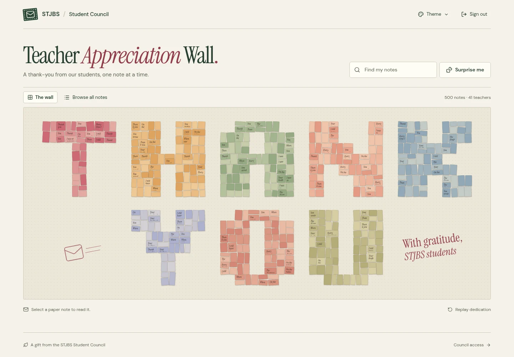

# STJBS Teacher Appreciation Wall

A private gift from students to teachers. Each approved note has an address within the **THANK YOU** lettering. As the collection grows, additional notes divide individual paper positions across the eight letters while preserving their silhouette. Teachers can find their collection, open individual notes and print or download a keepsake. Students choose their teacher and send notes from the public entrance. Council administrators approve notes for publication or move them to Trash. They can return rejected notes to review for 30 days.

## Run the local edition

Use Node.js 22.12 or later and npm. The local demo runs the compiled React application, Pages Functions and a synthetic D1 database through Wrangler.

```sh
npm ci
npm run build
npm run demo
```

Open [the local wall](http://127.0.0.1:8788), choose **I'm a teacher**, and use the demo passphrase `paper-garden`. Open [the local council desk](http://127.0.0.1:8788/admin) for the separate demo administrator sign-in. The demo fixture contains 500 invented notes for 41 teachers, including a 55-note collection for testing multi-page keepsakes.

```sh
npm run demo:reset
```

## Application and release

The browser interface is in `src/`, protected endpoints are in `functions/`, and the D1 schema is in `migrations/`. The teacher session and the council's Cloudflare Access identity are separate. Every protected read goes through the Functions layer.

Follow [the deployment runbook](setup.md) after approval. Production needs its own D1 binding, teacher passphrase, session secret, canonical host, Access configuration and allowlisted council identities. The owner supplies the approved note file privately. Keep private release inputs outside the checkout and static asset directory.

See [the build brief](docs/BUILD_PROMPT.md) for the full interaction and operating requirements.

## Verify the compiled demo

The browser checks use Puppeteer's Node API and a local Chromium installation. Export checks also use Poppler's PDF tools. Run the board check with the default demo running. Give the two mutating suites their own synthetic databases.

| Area | Start in a separate terminal | Run the check |
| --- | --- | --- |
| Board and motion | `npm run demo` | `npm run qa:board` |
| Zoom and pan | `npm run demo` | `npm run qa:zoom` |
| Council and data | `npm run demo -- --port 8792 --state /tmp/stjbs-qa-admin` | `npm run qa:admin` |
| Keepsakes | `npm run demo -- --port 8793 --state /tmp/stjbs-qa-export` | `npm run qa:export` |
| Student submissions and moderation | `npm run demo -- --port 8798 --state /tmp/stjbs-submission-qa` (fresh state) | `npm run qa:submissions` |
| Student and council browser flow | `npm run demo -- --port 8797 --state /tmp/stjbs-student-ui` (fresh state) | `npm run qa:student-ui` |
| Private seed | Creates an isolated local database | `npm run qa:seed` |

The zoom check drives the wall with mouse, wheel, keyboard, touch and pinch on a desktop and a phone viewport. Run the performance trace without other browser suites active. The reports cover [board interactions](docs/qa-board.md), [moderation and recovery](docs/qa-admin.md), and [PDF verification](docs/qa-export.md).



[Phone wall](docs/qa/wall-phone.webp) · [Council overview](docs/qa/council.webp) · [Keepsake workspace](docs/qa/keepsake.webp) · [Rendered PDF comparison](docs/qa/print-layouts.webp)
