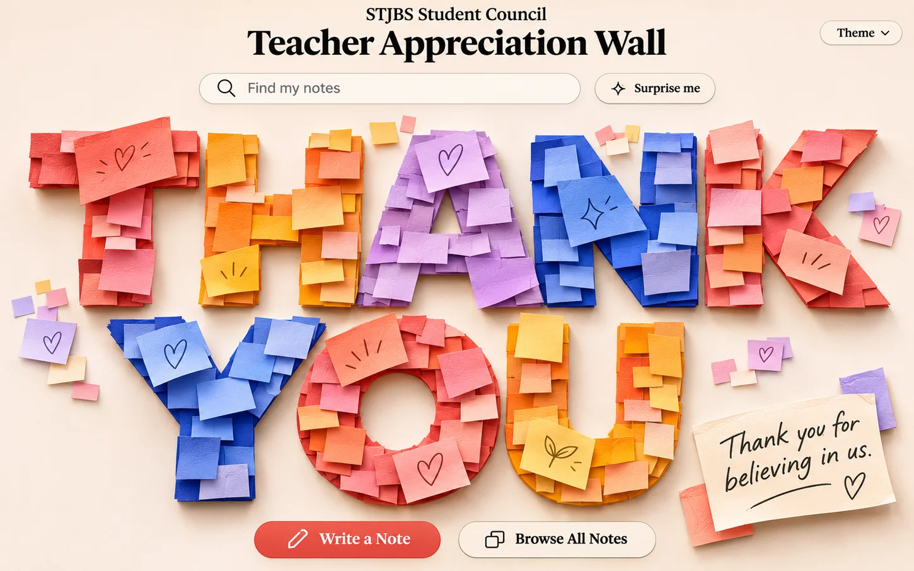
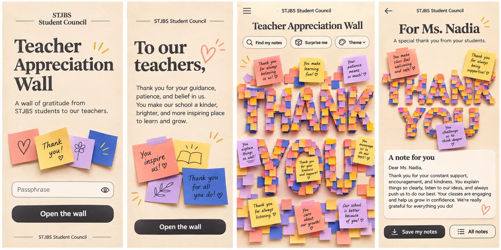
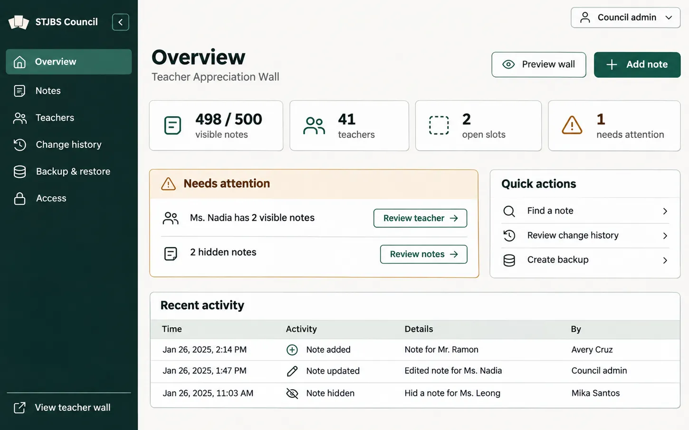
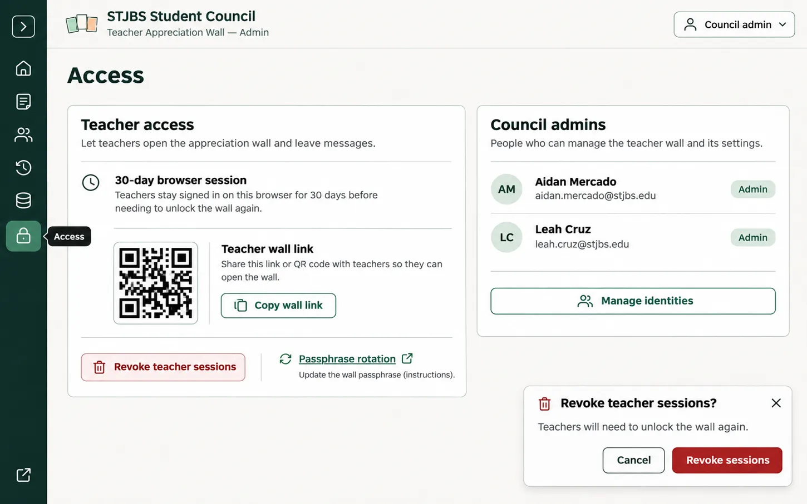
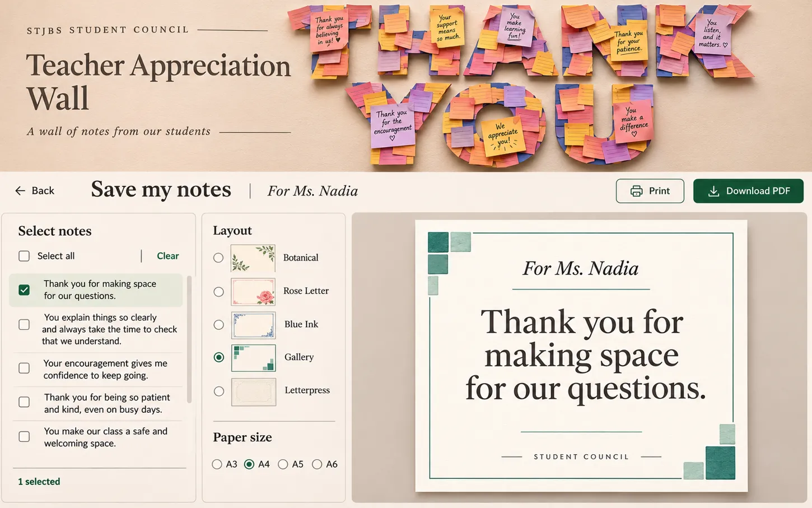

# Design references

**Use these as loose inspiration only.** They show a few useful ideas for visual hierarchy, paper depth and task organization. Build a stronger original interface with its own typography, spacing and interactions. Use the [build prompt](BUILD_PROMPT.md) for requirements. The screenshots contain synthetic copy and illustrative states.

## Teacher wall

Take the idea of notes at different scales forming the lettering. Real student-note excerpts, legible tap targets and a clear path into the reader carry the experience.

This is a sequence of four separate views, from passphrase through the personal reader.

## Admin

Use one shared navigation shell. Overview, Notes, Teachers, Change history, Backup & restore, and Access each open their own route. Use a contextual editor or details panel where it helps. The real teacher wall is read-only for teachers and sample access copy is illustrative.

## Export

Prioritize note selection, a live print preview and quick output. Render the actual selected paper dimensions. A4 starts in portrait.
