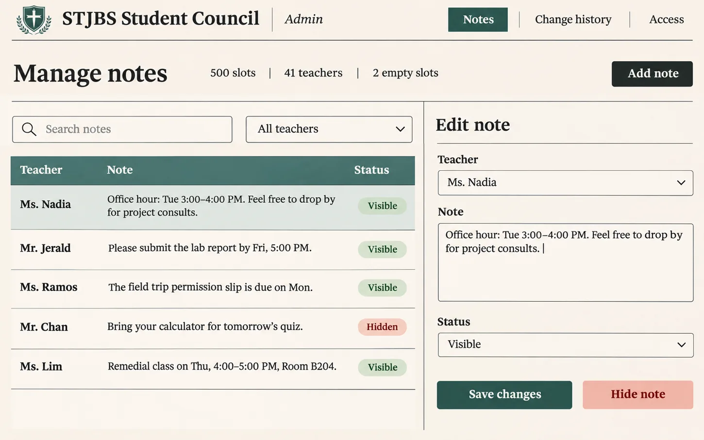
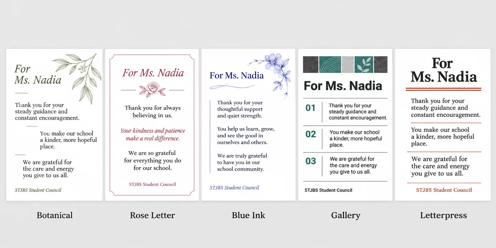

# Design references

These are design comps with sample content. The behavioral requirements live in the [build prompt](BUILD_PROMPT.md).

## Board

Keep the scale contrast, letter silhouettes, and paper depth. Show real excerpts on larger cards. Keep Find my notes above the composition and provide a browsable list on small screens. Omit the Write a Note control shown in the comp.

## Admin

Use the list-and-editor structure. Replace mock copy and any invented crest. Add explicit states for hidden notes, full capacity, conflicting edits, and unsaved or failed changes.

## Print

Treat these layouts as five distinct typographic styles. Build a preview using the teacher's selected notes and the chosen paper dimensions. Verify single-page and multi-page outputs.
